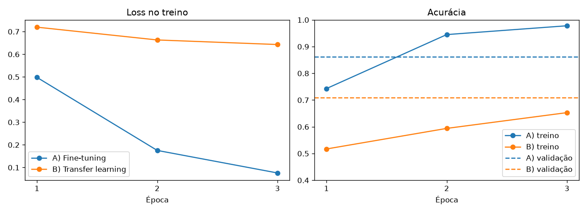

# Trocando o LM Head: classificação de sentimentos com BERT

Projeto da **Aula 09 — Ajustando um LLM**, da disciplina *Fundamentos de LLMs* (MBA em IA Generativa — UFPR).

Na aula, o LM Head do **Llama 3.2 1B** foi substituído por uma camada de classificação com 2 neurônios
(negativo/positivo) e o modelo foi ajustado (*fine-tuning*) no dataset SST-2. Este projeto aplica **a mesma
ideia com outro backbone, o BERT**, e compara duas estratégias de treino:

- **A) Fine-tuning completo:** todos os parâmetros do modelo são treinados.
- **B) Transfer learning:** o corpo do BERT é **congelado** e só a cabeça nova é treinada.

```
LLM original:  texto ──► [ corpo Transformer ] ──► [ LM Head: 768 → 30.522 ] ──► próximo token
Este projeto:  texto ──► [ corpo Transformer ] ──► [ cabeça nova: 768 → 2 ]  ──► negativo / positivo
```

## Resultados

Mesma configuração da aula: 1000 frases de treino, lote de 8, 3 épocas, avaliação nas 872 frases de validação do SST-2.

| Estratégia | Parâmetros treináveis | Tempo de treino* | Acurácia (validação) |
|---|---|---|---|
| Chute (sempre a classe mais comum) | — | — | 50,9% |
| **A) Fine-tuning completo (BERT)** | 109.483.778 (100%) | ~13 s | **86,2%** |
| B) Transfer learning, 3 épocas | 1.538 (0,0014%) | ~2,5 s | 71,0% |
| B) Transfer learning, 20 épocas | 1.538 (0,0014%) | ~17 s | 77,3% |
| *Referência: Llama 3.2 1B, fine-tuning (aula)* | *1.235.818.496* | *minutos* | *80,2%* |

\* Em uma NVIDIA RTX 5080.



**Principais conclusões**

1. A troca do LM Head funciona com o BERT: com a mesma receita da aula ele chegou a 86,2%, com um modelo
   ~11 vezes menor que o Llama 3.2 1B e treino de segundos.
2. Congelar o corpo reduz os parâmetros treináveis de 109 milhões para 1.538 e deixa cada época ~5 vezes mais rápida,
   mas a acurácia cai muito (71%, ou 77% com 20 épocas). Para esta tarefa, **treinar só a cabeça nova não é suficiente**:
   o corpo também precisa se ajustar para separar frases positivas e negativas.
3. Mesmo o melhor modelo mostra sinais de *overfitting* (97,8% no treino × 86,2% na validação) e de excesso de
   confiança (erra algumas frases com 99% de probabilidade).

A discussão completa está na última seção do notebook.

## Como executar

O projeto inteiro é o notebook [`classificador_sentimentos_bert.ipynb`](classificador_sentimentos_bert.ipynb).
O BERT **não precisa de token do Hugging Face** e roda até em CPU, só que mais devagar.

**Google Colab:** em *Arquivo → Abrir notebook → GitHub*, cole o link deste repositório.
Ative a GPU em *Ambiente de execução → Alterar o tipo de ambiente de execução → T4 GPU* e rode todas as células.

**Localmente:**

```bash
python3 -m venv .venv
source .venv/bin/activate
pip install -r requirements.txt
jupyter notebook classificador_sentimentos_bert.ipynb
```

> Para usar uma GPU NVIDIA, instale antes o PyTorch com CUDA seguindo https://pytorch.org/get-started/locally/
> (por exemplo, `pip install torch --index-url https://download.pytorch.org/whl/cu128`).

Para testar outro backbone, basta trocar `MODEL_ID` na célula de configuração (ex.: `distilbert-base-uncased`, `roberta-base`).

## Estrutura

```
├── classificador_sentimentos_bert.ipynb   # notebook do projeto, com explicações e resultados salvos
├── curvas_treinamento.png                 # gráfico gerado pelo notebook
├── requirements.txt                       # bibliotecas necessárias
└── README.md
```

## Referências

- Material da Aula 09 (Prof. Paulo Lisboa de Almeida) e notebooks de exemplo da aula.
- HOWARD, J.; RUDER, S. *Universal Language Model Fine-tuning for Text Classification*. ACL, 2018.
- DEVLIN, J. et al. *BERT: Pre-training of Deep Bidirectional Transformers for Language Understanding*. NAACL, 2019.
- SOCHER, R. et al. *Recursive Deep Models for Semantic Compositionality Over a Sentiment Treebank* (SST). EMNLP, 2013.
